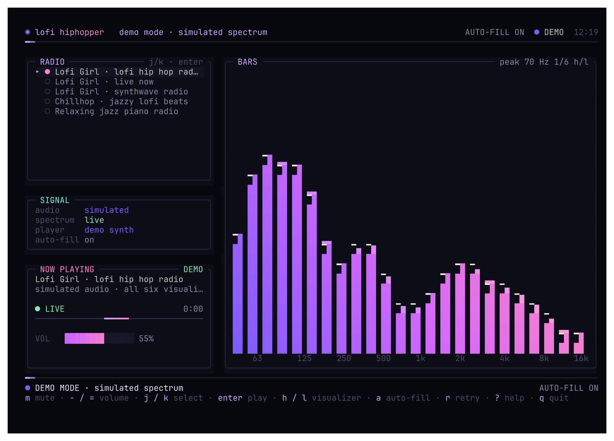
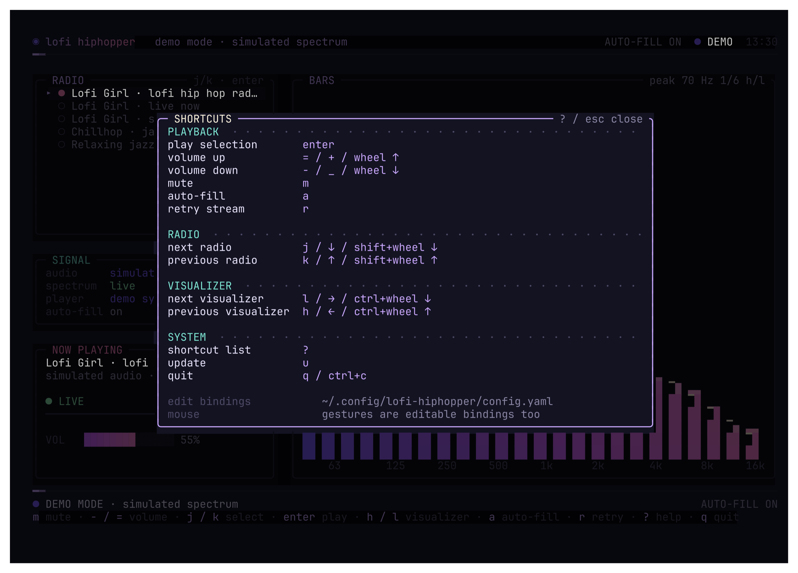
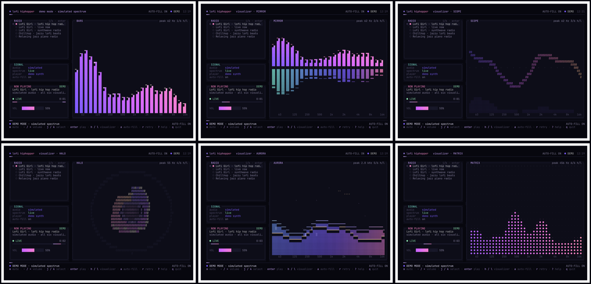
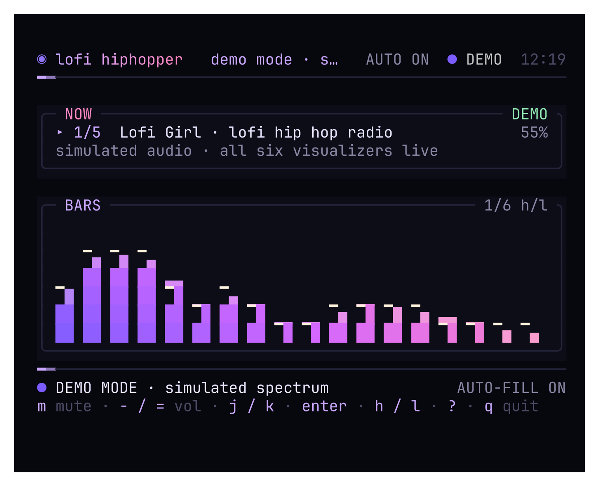

# lofi hiphopper

A tiny macOS terminal companion that fills silence with lofi, then gets out of
the way when you are on a call or already listening to something.

[Website](https://wilsonnet.github.io/lofi-hiphopper/) · [Releases](https://github.com/WilsonNet/lofi-hiphopper/releases)



*Screenshots use demo mode so they can be captured without playing audio. The
live app uses real system audio and real FFT data.*

It watches your Mac's audio activity, starts Lofi Girl when things are quiet,
and holds playback when another app is making sound or using the microphone.
It is a Charm Bubble Tea TUI with six animated spectrum visualizers.

## What it does

- Plays Lofi Girl's lofi hip hop livestream by default.
- Starts automatically when your Mac is silent.
- Yields to Spotify, YouTube, a call, or any other app using audio.
- Holds immediately when Zoom, Meet, FaceTime, Teams, or another app opens the
  microphone.
- Stops the stream while holding and resolves it again on return (default).
  Mute mode is opt-in for a seamless silent hold.
- Comes back after the call or other audio ends.
- Checks GitHub releases on launch. When a newer release exists, `u` appears
  in the footer; `u` opens an update dialog and can install and restart.
- Ignores its own player, so it never pauses itself.
- Lets you bypass apps that should never interrupt lofi, such as simulators or
  background tools.
- Keeps filling silence for as long as the TUI is open.
- Lets you mute, change volume, pick a radio, or change visualizers from the
  keyboard or mouse.

## Install

macOS 14.4 or newer for now. Linux support will come later.

Install the runtime dependencies:

```sh
brew install mpv yt-dlp ffmpeg
```

Then install the latest release with curl:

```sh
curl -fsSL https://raw.githubusercontent.com/WilsonNet/lofi-hiphopper/main/install.sh | bash
```

The installer puts the binary in `~/.local/bin`. If that directory is not on
your `PATH`, it prints the line to add. Pin a release or choose a location with:

```sh
curl -fsSL https://raw.githubusercontent.com/WilsonNet/lofi-hiphopper/main/install.sh | bash -s -- --version v0.3.3
curl -fsSL https://raw.githubusercontent.com/WilsonNet/lofi-hiphopper/main/install.sh | bash -s -- --prefix /opt/homebrew
```

Prefer building from source? Go 1.24+ is required:

```sh
git clone https://github.com/WilsonNet/lofi-hiphopper.git
cd lofi-hiphopper
go build -o bin/lofi-hiphopper .
./bin/lofi-hiphopper
```

Or run it directly:

```sh
go run .
```

No config file is required. The built-in defaults are embedded in the binary,
so the first launch simply starts filling silence. To customize, create the
file yourself:

```sh
mkdir -p ~/.config/lofi-hiphopper
lofi-hiphopper -print-config > ~/.config/lofi-hiphopper/config.yaml
```

Then edit only the parts you want; everything else stays at its default. Use
`-demo` to try the UI without any audio:

```sh
go run . -demo
```

Releases live at
[github.com/WilsonNet/lofi-hiphopper/releases](https://github.com/WilsonNet/lofi-hiphopper/releases).

## Keys

| Key | Action |
| --- | --- |
| `j` / `k` or `↓` / `↑` | Move the radio cursor |
| `enter` | Play the selected radio (queues during calls/other audio) |
| `h` / `l` or `←` / `→` | Previous / next visualizer |
| `m` | Mute / unmute |
| `-` / `=` | Volume down / up |
| `a` | Toggle auto-fill |
| `r` | Retry / restart the selected radio |
| `?` | Full shortcut sheet |
| `u` | Update to a newer release, when available |
| `q` / `ctrl+c` | Quit |

Mouse gestures work too:

| Gesture | Action |
| --- | --- |
| Wheel | Volume |
| Shift + wheel | Radio |
| Ctrl + wheel | Visualizer |

Every binding, including the mouse gestures, is editable in the optional config
file. Press `?` to see the live table.



## Visualizers

Six visualizers use the real frequency spectrum, not a canned animation. They
are smoothed and include falling peak caps and a dominant-frequency readout.



Switch with `h` / `l` or the mouse. The current names are:

- **BARS** — glowing bars and a live frequency ruler
- **MIRROR** — centre-out spectrum with a cool reflection
- **SCOPE** — braille oscilloscope over a dim spectrum
- **HALO** — circular polar spectrum with a pulsing core
- **AURORA** — layered spectrum clouds under a star field
- **MATRIX** — dot-matrix equalizer with a scanline

*Screenshots are real demo-mode frames rendered with Charm freeze.*

## Configuration

The config is an optional YAML file. If it does not exist, the app uses the
built-in defaults and creates nothing. If it exists, every section is optional:
omitted values use the built-in defaults. A radio list replaces the default
list. Shortcut entries merge by action, so you can change one key without
rewriting the whole table.

A small config can be just this:

```yaml
volume: 25
```

The default yield behavior is:

```yaml
hold_mode: stop
```

To ignore an app completely, list a process name, bundle ID, or path substring:

```yaml
bypass_apps:
  - "CoreSimulator"
  - "com.example.MyApp"
```

A radio and shortcut example:

```yaml
radios:
  - name: Lofi Girl · lofi hip hop radio
    url: https://www.youtube.com/watch?v=rFZHOHl-L8A
  - name: Lofi Girl · synthwave radio
    url: https://www.youtube.com/watch?v=4xDzrJKXOOY

shortcuts:
  - action: mute
    keys: ["x"]
  - action: next_radio
    keys: ["j", "shift+wheel_down"]
```

See [the full configuration reference](docs/configuration.md) for every field,
action, mouse token, and the complete default file.

When the window is narrow, the UI still works:



## How it works, briefly

It uses macOS CoreAudio process flags to see which apps are producing output or
using a microphone. A separate silent ffmpeg decode feeds the visualizers, while
mpv handles playback. While yielding it stops the stream by default and resolves
it again when silence returns. Set `hold_mode: mute` to keep streaming silently,
or `hold_mode: pause` to pause. It never records your microphone.

For the deep version, read:

- [Configuration](docs/configuration.md)
- [Architecture](docs/architecture.md)
- [Testing](docs/testing.md)
- [Development](docs/development.md)

## Development

```sh
gofmt -w .
go vet ./...
go test ./...
go test -race ./...
go build ./...
```

Real interactive tests use Herdr tabs. See [Testing](docs/testing.md) and the
portable skills in [`.agents/skills/`](.agents/README.md).

## Notes

- Lofi Girl livestream IDs change. Use a channel `/live` URL or edit the radio
  list when a specific stream retires.
- If YouTube breaks, `brew upgrade yt-dlp`.
- `ffmpeg` is needed for the real spectrum. Playback still works if the analyser
  fails.
- This is macOS-only. The CoreAudio probe has a stub for other platforms.
